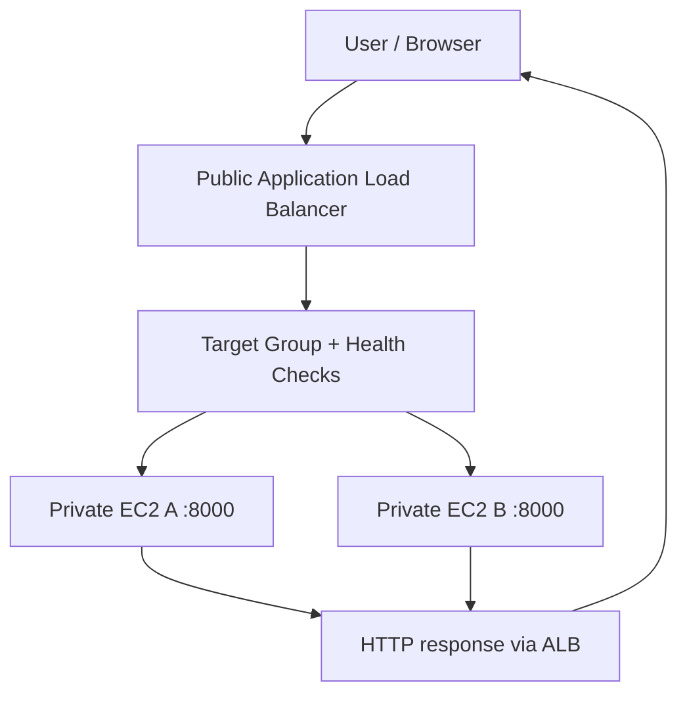
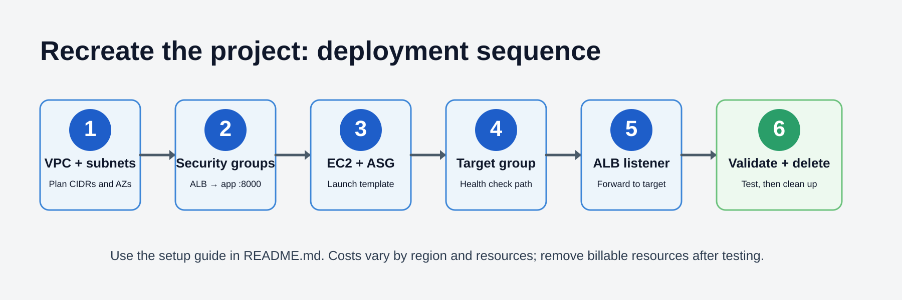

<div align="center">

# Scalable Web Application Architecture on AWS

### Don't judge a book by its cover — understand the engineering behind the URL.

A visual, hands-on project exploring load balancing, private application instances, health checks, capacity management, and cloud network security.


</div>

> **Project status:** The infrastructure was deployed for hands-on learning and then deleted to avoid ongoing charges. There is no live endpoint now. This repository documents the architecture and provides a guide to recreate it. Only mark a test as passed if you observed it during your deployment.

## At a glance

| Area | Design |
|---|---|
| Application | Lightweight Python HTTP server |
| Compute | EC2 instances managed by an Auto Scaling Group |
| Entry point | Application Load Balancer (ALB) |
| Network | VPC with public and private subnet roles |
| Traffic | ALB target group and health checks |
| Security | Security groups; controlled admin access if using a bastion |
| Next steps | CloudWatch, Terraform, CI/CD, HTTPS |

## 1. Architecture


The ALB provides the public entry point. It forwards requests to eligible application targets in the private tier. The Auto Scaling Group manages EC2 capacity; it does not perform load balancing.

## 2. Follow a request


1. A user opens the ALB DNS name.
2. The ALB listener receives the HTTP/HTTPS request.
3. A listener rule forwards it to the target group.
4. The ALB chooses an eligible healthy target.
5. The Python HTTP server on port `8000` processes the request.
6. The response returns through the ALB to the user.



## 3. How the project is secured


Security is about controlling which paths are allowed, not merely adding a firewall.

| Layer | Recommended control | Reason |
|---|---|---|
| Public entry | Allow only required ALB listener ports (`80` and/or `443`) | Limits exposed entry points |
| Application tier | Allow TCP `8000` from the **ALB security group only** | Prevents direct public access to the app port |
| Administration | If using SSH, allow port `22` only from a trusted admin IP/network | Avoids unrestricted SSH exposure |
| Identity | Use least-privilege IAM roles | Limits what AWS identities can do |
| Secrets | Never commit keys, tokens, or `.env` files | Prevents credential leaks |
| Transport | Use HTTPS with a valid certificate for a real public deployment | Encrypts browser-to-ALB traffic |
| Private egress | Use only the required NAT routes or VPC endpoints | Controls outbound dependencies |

**Important:** The table describes the intended security model. Check the actual security group rules, route tables, and subnet placement when recreating the environment. A private subnet does not automatically have internet access; a bastion host does not automatically provide it either.

## 4. Health checks vs. Auto Scaling

These solve different problems:

- **ALB health checks:** Determine whether a target is eligible to receive normal traffic.
- **Auto Scaling Group:** Maintains minimum, desired, and maximum instance capacity.
- **Scaling policy:** Changes capacity based on a metric or schedule.
- **ASG health-check configuration:** Must be set appropriately if load-balancer health should trigger instance replacement.

An ASG desired capacity of two does not, by itself, prove that CPU-based scale-out works.

## 5. Recreate the project



This is a console-first guide. Exact screen labels can change; verify settings before creating resources.

### Prerequisites

- An AWS account and access to the AWS Management Console.
- Permission to create VPC networking, EC2, load balancer, target group, Auto Scaling, and IAM resources.
- A budget alert and a plan to remove resources after testing.
- A small Python HTTP server that listens on `0.0.0.0:8000` and serves a successful health-check path.

### Step 1 — Plan the network

1. Choose one AWS Region.
2. Create a VPC, for example `10.0.0.0/16`.
3. Create at least two public subnets in separate Availability Zones for an internet-facing ALB.
4. Create private application subnets; use separate AZs if testing multi-AZ behavior.
5. Attach an Internet Gateway and route public subnet traffic to it.
6. Add private outbound connectivity only if required. NAT Gateways can cost money; consider VPC endpoints or temporarily pre-baked images where appropriate.

Example CIDRs (illustrative only):

| Resource | Example CIDR |
|---|---|
| VPC | `10.0.0.0/16` |
| Public subnet A | `10.0.1.0/24` |
| Public subnet B | `10.0.2.0/24` |
| Private subnet A | `10.0.11.0/24` |
| Private subnet B | `10.0.12.0/24` |

### Step 2 — Create security groups

Create separate security groups for the ALB and application instances.

- **ALB SG:** inbound `80` from allowed client ranges for a basic HTTP test, or `443` for HTTPS.
- **Application SG:** inbound TCP `8000` with the ALB SG as the source.
- **Bastion SG (optional):** inbound SSH only from your current trusted IP. Consider Systems Manager Session Manager instead.

Do not make port `8000` publicly accessible. Do not open SSH to `0.0.0.0/0`.

### Step 3 — Prepare the application instance configuration

1. Create a launch template for EC2.
2. Select a suitable small instance type and a supported operating system.
3. Configure the application security group.
4. Add user data or another repeatable mechanism to install/start the Python server on boot.
5. Ensure the server listens on `0.0.0.0:8000`.
6. Ensure the target group health-check path returns a successful status.

For a reproducible project, prefer a known script or image rather than manually configuring each instance differently.

### Step 4 — Create the target group

1. Create an instance target group.
2. Set protocol HTTP and target port `8000`.
3. Select a health-check path served successfully by the application, such as `/`.
4. Register targets directly for an initial test, or attach the target group to the Auto Scaling Group so instances register automatically.
5. Confirm targets become healthy before proceeding.

### Step 5 — Create the Application Load Balancer

1. Create an **internet-facing** ALB.
2. Select the public subnets in at least two Availability Zones.
3. Attach the ALB security group.
4. Create an HTTP listener on port `80` for an initial learning test, forwarding to the target group.
5. For a real public-facing deployment, configure HTTPS with a certificate and an appropriate redirect from HTTP.

### Step 6 — Create the Auto Scaling Group

1. Create an ASG from the launch template.
2. Select the private application subnets.
3. Attach the target group.
4. Set sensible minimum, desired, and maximum capacities for the test.
5. Configure ELB health checks if you want load-balancer health to influence replacement decisions.
6. Add a scaling policy only when ready to test it; CPU-based target tracking is one option.

### Step 7 — Validate the end-to-end path

- Open the ALB DNS name in a browser.
- Confirm the application responds.
- Check target health in the target group.
- If the response includes the instance hostname, send repeated requests and observe which targets respond.
- In a controlled test, stop the application on one instance and observe target health and routing.
- Test scaling separately by checking the policy, CloudWatch metrics, and ASG activity history.

**Do not run aggressive load tests against a small or unmonitored environment.** Start with a modest request rate and stop if errors or unexpected charges appear.

### Step 8 — Clean up

When finished, remove resources you no longer need. Review dependencies before deletion:

1. Delete the Auto Scaling Group or reduce capacity and disable policies as appropriate.
2. Delete the ALB and target group when no longer needed.
3. Delete unused launch templates and EC2 resources.
4. Remove the NAT Gateway if created, then its associated routes and addresses as applicable.
5. Delete unused bastion instances, Elastic IPs, and other resources.
6. Review the VPC and billing console to confirm that no billable resources remain.

Deleting only the EC2 instances is not enough to guarantee that all AWS charges stop.

## 6. Validation checklist

- [ ] ALB DNS name returns the expected response.
- [ ] Target group shows the expected registered and healthy targets.
- [ ] Application port `8000` is allowed only from the ALB security group.
- [ ] Target failure is detected by health checks.
- [ ] ASG replacement behavior is verified if configured.
- [ ] Scaling policy behavior is observed if configured.
- [ ] CloudWatch metrics and alarms are reviewed if configured.
- [ ] Resources are removed after testing.

Keep screenshots and logs under `docs/test-results/` only when you have them. Configuration alone is not proof of a successful test.

## 7. Roadmap

| Version | Planned work |
|---|---|
| 1.1 | CloudWatch dashboards, alarms, failure-recovery evidence |
| 1.2 | Terraform infrastructure as code |
| 1.3 | GitHub Actions CI/CD |
| 2.0 | Docker and optional ECS deployment |
| Future | HTTPS, Systems Manager, secret management, cost controls |

## Repository structure

```text
aws-scalable-web-architecture/
├── README.md
├── docs/
│   ├── architecture.png
│   ├── security-model.png
│   ├── setup-workflow.png
│   └── request-flow.gif
└── .gitignore
```

## Skills showcased

**AWS:** VPC, EC2, ALB, target groups, Auto Scaling concepts.  
**Networking:** Public/private subnet roles, routing, security group boundaries.  
**Security:** Least privilege, restricted ingress, controlled administration, secret hygiene.  
**Reliability:** Health checks, target eligibility, capacity management, failure scenarios.  
**Engineering practice:** Architecture communication, validation planning, cost awareness, reproducible setup roadmap.

## Author

**Gokul E** · IT graduate interested in AWS, cloud infrastructure, DevOps, and automation.

[GitHub profile](https://github.com/gokul-200)

---

*Built to understand what happens behind a web application's public URL—from the first request to the application server and back again.*
