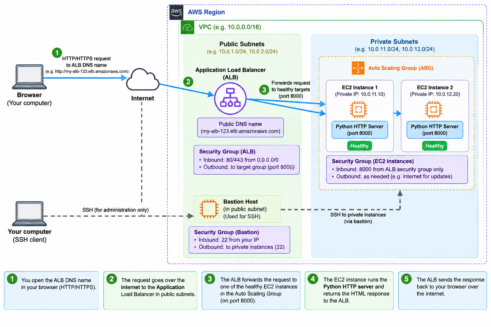
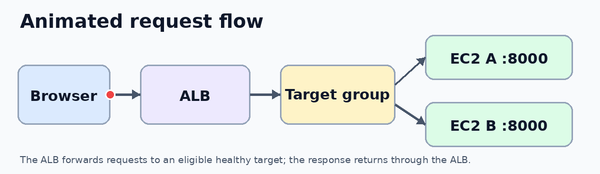
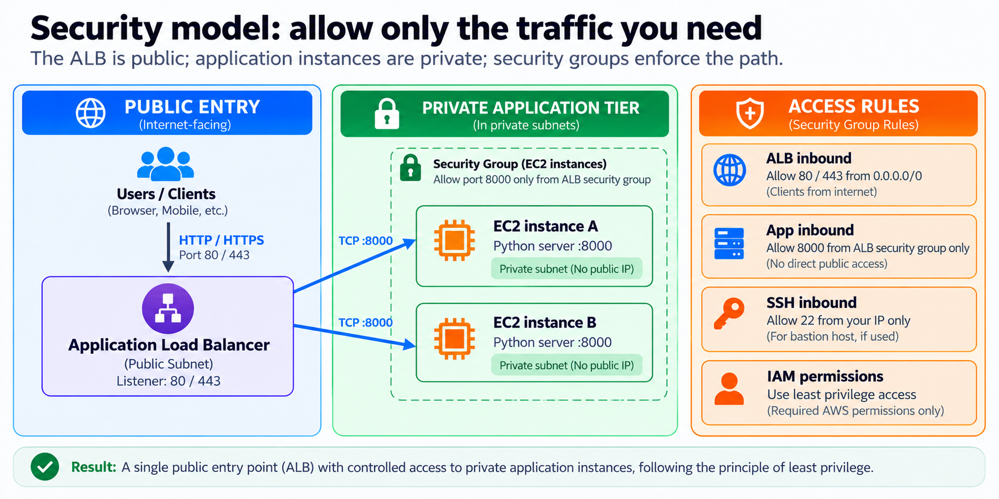

# Scalable Web Application Architecture on AWS

> Don't judge a book by its cover. Understand the engineering behind the URL.

A web page served from EC2 instances (Ubuntu) in private subnets behind an Application Load Balancer, with an Auto Scaling Group, health checks, and security-group-based network isolation. The page shows **which instance answered**, so load balancing and failure recovery are visible in the browser.

  

> **Project status:** Built manually in the AWS Management Console for hands-on learning, then deleted to avoid charges. There is no live endpoint. Infrastructure as code is on the roadmap, not part of this version. The validation table below is only ticked for tests I observed.

## Architecture



| Layer | Design |
|---|---|
| OS / AMI | Ubuntu Server LTS (Canonical AMI) |
| App | Python 3 standard-library web server on port `8000` |
| Entry point | Internet-facing Application Load Balancer, HTTP listener on `80` |
| Compute | Auto Scaling Group across two Availability Zones, instances in private subnets |
| Health | Target group health check on `/health` |
| Network | VPC with public and private subnets, Internet Gateway, NAT Gateway for outbound package installs |
| Access | Session Manager, or a bastion host with SSH limited to your IP |

### Request flow



1. The browser requests the ALB DNS name on port 80.
2. The listener forwards to the target group.
3. The ALB picks a healthy target in a private subnet.
4. The Python server on `:8000` answers; `/api/info` returns the instance ID and AZ.
5. The response returns through the ALB.

The ALB balances traffic. The Auto Scaling Group only manages how many instances exist.

## Repository layout

```
.
├── app/
│   ├── server.py        # /, /health, /api/info
│   └── index.html       # page showing which instance answered
├── scripts/
│   ├── user-data.sh     # EC2 boot script for Ubuntu: installs and starts the app
│   ├── verify.sh        # counts which instance answers N requests
│   └── loadtest.sh      # modest load to trigger scale-out (uses hey)
├── docs/                # diagrams and test-results/
├── .gitignore
├── LICENSE
└── README.md
```

## Build it in the console

### 1. Network
1. Pick one Region and create a VPC, e.g. `10.0.0.0/16`.
2. Create two public subnets and two private subnets, each pair in different AZs (e.g. `10.0.1.0/24`, `10.0.2.0/24`, `10.0.11.0/24`, `10.0.12.0/24`).
3. Attach an Internet Gateway; route the public subnets' `0.0.0.0/0` to it.
4. Create a NAT Gateway in a public subnet; route the private subnets' `0.0.0.0/0` to it (instances need it for `apt` and downloads). NAT Gateways cost money while they exist.

### 2. Security groups
| Group | Inbound |
|---|---|
| `alb-sg` | TCP 80 from `0.0.0.0/0` (or just your IP while testing) |
| `app-sg` | TCP 8000 from `alb-sg` only |
| `bastion-sg` (optional) | TCP 22 from your IP only |

Never open port 8000 or SSH to `0.0.0.0/0`.

### 3. Launch template
- AMI: **Ubuntu Server 24.04 LTS** (or the Ubuntu LTS you used), instance type `t3.micro` or similar
- Security group: `app-sg`
- Advanced details: metadata version **V2 only**; attach an IAM instance profile with `AmazonSSMManagedInstanceCore` if using Session Manager
- User data: paste `scripts/user-data.sh`

### 4. Target group and ALB
1. Create an **instance** target group: HTTP, port `8000`, health check path `/health`.
2. Create an **internet-facing** ALB in the two public subnets with `alb-sg`.
3. Add an HTTP:80 listener forwarding to the target group.

### 5. Auto Scaling Group
1. Create the ASG from the launch template in the two private subnets.
2. Attach the target group and enable **ELB health checks**.
3. Set min 2, desired 2, max 4 and a health check grace period of about 180 seconds.
4. Add a target tracking policy on average CPU (e.g. 50%).

Targets take a few minutes to turn healthy because each instance runs `apt` and downloads the app on first boot.

## Commands used on the Ubuntu instance

```bash
lsb_release -a                          # confirm the Ubuntu version
sudo cat /var/log/user-data.log         # boot script output
systemctl status webapp                 # service state
journalctl -u webapp -f                 # live request logs
ss -tlnp | grep 8000                    # confirm listening on 0.0.0.0:8000
curl -s localhost:8000/health           # expect: ok
curl -s localhost:8000/api/info         # instance ID, AZ, private IP
```

Connect with Session Manager (`aws ssm start-session --target <instance-id>`) or through the bastion with `ssh -i key.pem ubuntu@<private-ip>`.

### First version: a single web page by hand

```bash
sudo apt update && sudo apt install -y python3
mkdir ~/site && cd ~/site
echo "<h1>Hello from $(hostname)</h1>" > index.html
python3 -m http.server 8000             # serves index.html on port 8000
```

This works for a first test but stops when the terminal closes and has no `/health` endpoint or auto-restart. `app/` and `scripts/user-data.sh` replace it with a proper service that restarts itself (systemd).

## Test and validate

```bash
./scripts/verify.sh <alb-dns-name> 20    # distribution across instances
```

**Failure recovery:** on one instance run `sudo systemctl stop webapp`. In EC2 > Target Groups > Targets, watch it turn unhealthy while the other instance keeps serving, then check **ASG > Activity** for the replacement. CLI equivalents:

```bash
aws elbv2 describe-target-health --target-group-arn <target-group-arn>
aws autoscaling describe-scaling-activities --auto-scaling-group-name <asg-name> --max-items 5
```

**Scale-out** (keep it modest and watch the bill):

```bash
./scripts/loadtest.sh <alb-dns-name> 300 20    # needs: sudo apt install hey
```

### Validation status

Tick a box only after saving evidence in [`docs/test-results/`](docs/test-results/).

| Test | Observed |
|---|---|
| Targets healthy across 2 AZs | [ ] |
| Page loads through the ALB | [ ] |
| Requests spread across instances | [ ] |
| Stopped app detected as unhealthy | [ ] |
| ASG replaced the failed instance | [ ] |
| CPU scale-out observed | [ ] |

## Security model



| Control | Implementation |
|---|---|
| Only the ALB is public | Instances sit in private subnets with no public IP |
| App port locked to the ALB | `app-sg` allows TCP 8000 from `alb-sg` only |
| Restricted administration | SSH only from your IP via a bastion, or Session Manager with no inbound port |
| IMDSv2 only | Launch template requires metadata tokens |
| Least privilege | Instance role limited to Session Manager access |
| Secrets | `.gitignore` blocks `.env` and key files |

## Design decisions and trade-offs

- **ALB over NLB:** HTTP-aware health checks and per-request balancing.
- **Private subnets + NAT:** instances are unreachable from the internet but still need outbound access. One NAT Gateway is cheapest but not AZ-resilient.
- **ELB health checks on the ASG:** the default EC2 check only notices dead VMs; with ELB checks, a stopped or hung app also triggers replacement.
- **Grace period:** gives user data time to finish so booting instances aren't killed.
- **User data pulls from GitHub:** one source of truth for the app, but boot depends on GitHub; production would bake an AMI.
- **HTTP only:** fine for a short learning test; real deployments need ACM and an HTTPS listener.

## Cost and cleanup

While running, the NAT Gateway, ALB and EC2 instances are the main charges. Delete in this order, then check the billing console:

1. Auto Scaling Group (set capacity to 0 first)
2. Load balancer, then target group
3. Launch template and bastion instance (if any)
4. NAT Gateway, then release its Elastic IP
5. Subnets, route tables, Internet Gateway, VPC

## Troubleshooting

| Symptom | Check |
|---|---|
| Targets stay unhealthy | `sudo cat /var/log/user-data.log`; a missing NAT route makes `apt` fail |
| `502`/`503` from the ALB | `systemctl status webapp`; confirm `app-sg` allows 8000 from `alb-sg` |
| Page times out | `alb-sg` may not allow your IP |
| Instances keep being replaced | Increase the health check grace period |

## Roadmap

| Version | Work |
|---|---|
| 1.1 | CloudWatch alarms and dashboard; HTTPS with ACM |
| 1.2 | Rebuild the same stack with Terraform |
| 1.3 | GitHub Actions checks (`terraform validate`, `tflint`) |
| 2.0 | Docker image and ECS Fargate variant |

## Author

**Gokul E**, IT graduate interested in AWS, cloud infrastructure, DevOps, and automation. [GitHub](https://github.com/gokul-200)

Licensed under the [MIT License](LICENSE).
